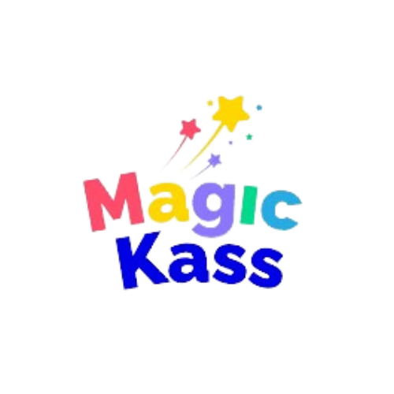

<div dir="rtl" align="center">



# 🎢 מג'יק קאס – Magic Kass

### אתר לפארק השעשועים המקורה הגדול בישראל

**12 מתקני אקסטרים · מעל 100 משחקי ארקייד · 13 דונם של כיף**


</div>

<div dir="rtl">

## ✨ על הפרויקט

**מוכנים לזה?** 🎡

האתר הוא אתר תדמית והזמנות לפארק השעשועים **מג'יק קאס** שבמעלה אדומים. הפארק נבנה בהשקעה של חצי מיליארד שקל, ורובו מקורה וממוזג. באתר אפשר להכיר את המתקנים, לקרוא תגובות של מבקרים, למצוא תשובות לשאלות נפוצות ולהזמין כרטיסים.

הוא נבנה מאפס ב-**HTML** וב-**CSS** בלבד.

## 🗺️ מה יש באתר

| | עמוד | מה תמצאו בו |
|:-:|---|---|
| 🏠 | **דף הבית** | סרטון פתיחה, תמונות של הפארק מבפנים ומבחוץ ומפת הגעה |
| 🎠 | **מתקני הפארק** | גלריה של המתקנים: רכבת הרים, גלגל ענק, הסוכרייה, בראשית ועוד |
| ❓ | **שאלות נפוצות** | הוראות בטיחות ותשובות על שעות פתיחה, חניה, הסעות, נגישות וימי הולדת |
| 🎟️ | **רכישת כרטיסים** | טופס הזמנה עם פרטים אישיים, תאריך הגעה, מספר משתתפים ואמצעי תשלום |
| ✅ | **אישור הזמנה** | עמוד שמאשר שהרכישה הצליחה |
| 💬 | **תגובות לקוחות** | ביקורות ודירוגים של מבקרים שכבר היו בפארק |

## 🎨 מה מעניין בקוד

- 🎬 **סרטון רקע** שמתנגן בראש דף הבית
- 🧭 **תפריט ניווט אחיד** בכל העמודים
- 📝 **טופס הזמנה** עם שדות מסוגים שונים: טקסט, תאריך, מספר, אימייל ותיבת סימון
- ⭐ **כרטיסיות תגובות** מעוצבות עם Bootstrap
- 🔗 **פוטר** עם קישורים לרשתות החברתיות ואייקונים של Font Awesome
- 🇮🇱 **עיצוב מימין לשמאל (RTL)** שמתאים לעברית

## 📁 מבנה הפרויקט

</div>

```
magic-kass/
├── home.html          ← דף הבית (מתחילים מכאן!)
├── home.css
├── all.css            ← עיצוב משותף לכל העמודים
├── pages/
│   ├── sacility.html  ← מתקני הפארק
│   ├── question.html  ← שאלות נפוצות
│   ├── order.html     ← רכישת כרטיסים
│   ├── save.html      ← אישור הזמנה
│   └── comment.html   ← תגובות לקוחות
├── css/               ← עיצוב לכל עמוד
├── bootstrap/         ← ספריית Bootstrap
└── images/            ← תמונות וסרטונים
```

<div dir="rtl">

## 🚀 איך מריצים

לא צריך להתקין שום דבר.

1. מורידים את הפרויקט:
</div>

```bash
git clone https://github.com/Rachel-Altshouler/magic-kass.git
```

<div dir="rtl">

2. פותחים את הקובץ `home.html` בדפדפן. ב-VS Code אפשר גם להשתמש בתוסף **Live Server**.
3. נהנים מהנסיעה! 🎢

---

<div align="center">

נבנה באהבה על ידי **רחל אלטשולר** 💜

*אם הפרויקט מצא חן בעיניכם, אפשר לתת לו ⭐*

</div>

</div>
